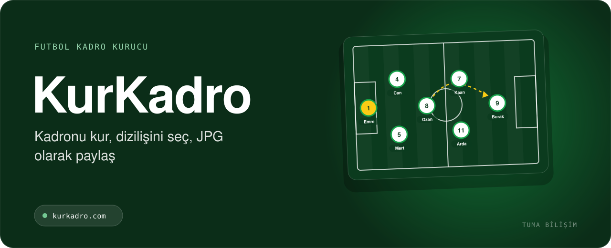

  

    

<h3 align="center">Halı saha oynayanlar için ücretsiz platform. Sürükle-bırak kadro kur, eksik oyuncu ve hakem bul, maçları ve puanları takip et.</h3>

 

> 🧪 Kadro kurucunun ilk açık kaynak prototipi: [halisaha-kadro](https://github.com/gkhnfyz/halisaha-kadro)

## 🎯 Kimler için?

- Amatör halı saha oyuncuları
- Eksik oyuncu arayan takım kaptanları
- Bölgesinde maç arayan hakemler

## ✨ Öne çıkan özellikler

- Sürükle-bırak kadro kurucu, taktik çizimi; link veya görsel olarak paylaşma (hesap gerekmez)
- Mevki, seviye ve konuma göre oyuncu bulma; profiller ve puanlar
- Takım yönetimi: logo, üye daveti, açık mevkiler için ilan
- Konuma ve puana göre hakem bulma, maç talebi ve teklif karşılaştırma
- Maç sonucu, oyuncu puanlama, rozetler ve liderlik tablosu
- Uygulama içi mesajlaşma

## 🧱 Teknoloji

`JavaScript` `Canvas` `PHP` `MySQL`

## 📬 Demo, kurulum ve fiyat

KurKadro için canlı demo, kurulum ve fiyat bilgisi almak isterseniz:

- 🌐 **Teklif formu:** [tumabilisim.com/iletisim](https://tumabilisim.com/iletisim?urun=KurKadro)
- 💬 **WhatsApp:** [+90 533 432 15 12](https://wa.me/905334321512?text=Merhaba%2C%20KurKadro%20hakk%C4%B1nda%20bilgi%20almak%20istiyorum.)
- ✉️ **E-posta:** [info@tumabilisim.com](mailto:info@tumabilisim.com?subject=KurKadro%20hakk%C4%B1nda)

İşletmenize özel uyarlama ve entegrasyon da yapıyoruz.

---

<b>🇬🇧 English</b>

 

**KurKadro** — Free five-a-side football platform: drag-and-drop lineup builder with tactic drawing, player and referee finder, team management, match ratings, badges and messaging.

Live product: https://kurkadro.com · Contact: [info@tumabilisim.com](mailto:info@tumabilisim.com) · WhatsApp: [+90 533 432 15 12](https://wa.me/905334321512)

---

Bu depo ürün tanıtımı içindir. Ürün ticari bir yazılım olduğundan kaynak kodu paylaşılmamaktadır. Kurulum, demo ve fiyat bilgisi için iletişime geçin. 
Tasarım & Geliştirme: <a href="https://tumabilisim.com">Tuma Bilişim</a> · <a href="https://github.com/gkhnfyz">@gkhnfyz</a>
